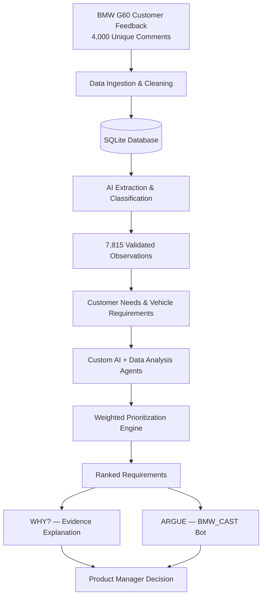
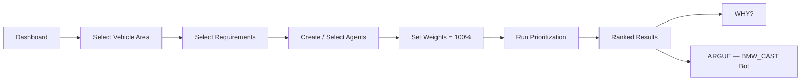

# BMW_CAST — ProductMind AI

**AI-powered customer intelligence and evidence-based vehicle requirement prioritization for the BMW 5 Series (G60).**

BMW_CAST turns thousands of unstructured customer comments into validated, traceable evidence, lets product managers
evaluate vehicle requirements with configurable AI and data agents, and explains every ranking. Product managers can
challenge any result in a conversation with **BMW_CAST Bot**.

> Built by **Team BMW_CAST** for the BMW Product Management Hackathon. Independent hackathon prototype, not an
> official BMW product or service.

| | |
|---|---|
| Vehicle | BMW 5 Series G60 |
| Customer comments analysed | 4,000 unique G60 comments |
| Validated AI observations | 7,815 (several observations can come from one comment) |
| Interface | Streamlit web app: Dashboard and a 4-step Product Prioritization workflow |
| AI provider | OpenAI (`gpt-5.6-luna`, structured outputs), via one shared client |
| Automated tests | 255 (all external AI calls mocked) |

---

## Contents

1. [Problem Statement](#1-problem-statement)
2. [Our Solution](#2-our-solution)
3. [Key Features](#3-key-features)
4. [System Architecture](#4-system-architecture)
5. [Dataset and AI Processing Results](#5-dataset-and-ai-processing-results)
6. [End-to-End User Workflow](#6-end-to-end-user-workflow)
7. [Custom AI Agent Configuration](#7-custom-ai-agent-configuration)
8. [Prioritization and Scoring Methodology](#8-prioritization-and-scoring-methodology)
9. [WHY Explanations and BMW_CAST Bot](#9-why-explanations-and-bmw_cast-bot)
10. [Technology Stack](#10-technology-stack)
11. [Installation and Environment Setup](#11-installation-and-environment-setup)
12. [How to Run the Streamlit Application](#12-how-to-run-the-streamlit-application)
13. [Demo Walkthrough](#13-demo-walkthrough)
14. [Testing and Validation](#14-testing-and-validation)
15. [Security and Data Privacy](#15-security-and-data-privacy)
16. [Known Limitations](#16-known-limitations)
17. [Future Improvements](#17-future-improvements)
18. [Team BMW_CAST and Hackathon Information](#18-team-bmw_cast-and-hackathon-information)

---

## 1. Problem Statement

BMW collects large volumes of free-text customer feedback. For a single model such as the 5 Series (G60) there are
thousands of comments, each classified with technical VFC categories but not with what the customer actually wants.

This creates four problems for product managers:

- **Unstructured evidence.** A comment can praise one feature and criticise another. Counting categories mixes
  complaints, wishes and praise.
- **No link from evidence to requirements.** Requirements and prioritization decisions are hard to trace back to
  specific customer statements.
- **Opaque prioritization.** Scoring is often subjective or done in spreadsheets, and nobody can say why item A ranks
  above item B.
- **AI risk.** Language models can summarise feedback quickly, but they can also invent counts, quotes or scores.

## 2. Our Solution

BMW_CAST follows one principle:

> **AI identifies evidence. Python calculates scores. Humans make decisions.**

1. **Extract once, reuse everywhere.** Every G60 comment is analysed once by the AI into typed observations
   (complaint, improvement request, positive, neutral, unclear). Each observation keeps a verbatim excerpt that is
   checked against the original comment, plus its feedback ID.
2. **Link evidence to requirements.** Requirements are generated from customer-need clusters. Each requirement keeps
   references to the distinct customer comments that support it.
3. **Configurable agents evaluate requirements.** Product managers choose or create agents (AI Analysis or Data
   Analysis), assign resources and set weights.
4. **Deterministic scoring.** Python counts unique supporting comments, normalises them with a fixed, documented formula
   and combines agent scores with the selected weights. The language model never chooses a number.
5. **Explain and challenge.** Every ranked requirement has **WHY?**, an evidence-based explanation, and **ARGUE**, a
   conversation with BMW_CAST Bot grounded in the saved results.

BMW_CAST reduces unsupported AI conclusions through evidence traceability, validated references and deterministic
scoring.

## 3. Key Features

| Feature | What it does |
|---|---|
| **Customer intelligence dashboard** | Live counts, top customer problems, top improvement requests, most appreciated features, needs by vehicle area. Every finding opens its supporting excerpts. |
| **AI feedback classification** | 4,000 comments, 7,815 validated observations, stored in SQLite and linked to the original comment |
| **Normalised customer-need taxonomy** | 18 need categories mapped from the original BMW VFC classification (which is preserved unchanged) |
| **Requirement generation** | Evidence-based rule-based drafts from customer-need clusters, saved through a draft/review workflow (never auto-approved) |
| **Custom agents** | Seven-field Agent Builder with document uploads (PDF, XLSX, CSV, TXT, MD) and per-agent resource isolation |
| **Evidence-first AI analysis** | OpenAI judges which validated observations are relevant to a requirement for each agent; results are cached and versioned |
| **Weighted prioritization** | Agent weights must total exactly 100 %. Python computes scores and the ranking. Every run is a reproducible snapshot. |
| **WHY?** | Offline, evidence-grounded explanation of each priority: customer problems, complaints, requests, agent perspectives, uncertainty |
| **BMW_CAST Bot (ARGUE)** | OpenAI-powered debate per requirement, using the saved evidence. It can propose weight scenarios but never changes the original ranking. |
| **Cost control** | Every AI call is logged with token usage and estimated cost against an application budget |
| **Advanced tools** | Data quality, source management, evidence explorer, customer insights, requirement review, agent history, what-if simulation, Excel/CSV/PDF reports |

## 4. System Architecture



The AI extraction results stay linked to the original evidence. Observations, requirement evidence links, agent
analyses and prioritization snapshots all reference feedback IDs stored in the same SQLite database.

| Layer | Implementation (in `BMW_ProductMind_AI/`) |
|---|---|
| Ingestion and validation | `scripts/initialize_database.py`, `services/data_ingestion.py`, `services/data_validation.py` |
| Storage | SQLite + SQLAlchemy (`core/models.py`, `core/ai_models.py`, `core/evidence_models.py`, …). AI tables are migrated additively and never dropped. |
| AI extraction | `services/ai_feedback_analysis.py` (batched, cached, checkpointed, verbatim-excerpt validation) |
| Evidence selection | `services/ai_evidence_selector.py` (requirement-specific matches + human review) |
| Agents and AI analysis | `services/agent_configuration.py`, `services/agent_analysis.py`, `services/agent_documents.py` |
| Scoring engine | `services/agent_scoring.py`, `services/dynamic_prioritization.py` |
| Explanations and debate | `services/product_workflow.py` (WHY), `services/argue_chat.py` (BMW_CAST Bot) |
| LLM provider and budget | `services/llm_client.py` (shared OpenAI client), `services/llm_budget.py` |
| User interface | `app.py`, `ui/pages/dashboard.py`, `ui/pages/product_prioritization.py`, advanced pages in `ui/pages/` |

## 5. Dataset and AI Processing Results

**Sources used by the application:**

- G60 customer feedback (the analysis scope), plus F70 and G70 feedback that is kept but excluded from G60 analysis
- BMW customer studies
- Sales volumes
- Option lists (equipment)
- Curated public BMW owner feedback
- Public competitor observations

**AI processing results** (from the project database):

| Metric | Result |
|---|---|
| Unique BMW G60 comments | 4,000 |
| Original G60 VFC classification records | 5,005 |
| G60 comments processed by AI extraction | 4,000 |
| Validated AI observations | 7,815 |
| Complaint observations | 2,885 |
| Improvement-request observations | 812 |
| Positive observations | 3,638 |
| Neutral observations | 416 |
| Unclear observations | 64 |

**Observations are not customers.** One comment can contain several observations, for example praise for the seats and
a complaint about the touchscreen. All customer counts shown in the application are therefore **distinct feedback IDs**.
For example, the 2,885 complaint observations come from 1,624 unique comments.

**How extraction works:**

1. Comments are sent in small batches as JSON data. They are never sent as instructions.
2. The model returns structured JSON with these fields per observation:
   - type
   - customer need
   - vehicle system
   - verbatim excerpt
   - confidence
   - taxonomy category
3. Python validates every result:
   - feedback IDs must belong to the batch and to G60
   - excerpts must appear verbatim in the original comment
   - unsupported observations are rejected and logged
4. Observation IDs are generated in Python. Results are cached per feedback ID, text hash, model, prompt version and
   taxonomy version, so nothing is re-processed or silently overwritten.

**How evidence is linked to requirements.** Each requirement is generated from a customer-need cluster and stores
evidence links: direct G60 comments, supporting public feedback and studies, and contextual competitor and equipment
items. For prioritization, an evidence selection maps the validated observations of the requirement's comments to the
requirement. Human reviewers can accept, reject or mark matches uncertain, and their decisions always take precedence.

## 6. End-to-End User Workflow



1. **Dashboard.** See what G60 customers say and click **START PRODUCT PRIORITIZATION**.
2. **Step 1, Vehicle Area.** Choose one, several or all areas, and optionally specific features (original BMW feedback
   topics). A deduplicated evidence preview shows relevant comments, complaints and requests.
3. **Step 2, Requirements.** Select saved requirements. Customer needs without a requirement can be turned into a draft
   and saved.
4. **Step 3, AI Agents.** Select agents or create one inline, then set weights that total 100 %.
5. **Run Prioritization.** Agents evaluate every selected requirement and the app moves to the results.
6. **Step 4, Decision Results.** A ranked list with **WHY?** and **ARGUE** under every requirement, plus a what-if
   weights simulation, an Excel report, and the option to start a new run.

## 7. Custom AI Agent Configuration

Agents are created in **Product Prioritization → Step 3 → + CREATE AGENT**. Each agent has seven fields:

| Field | Purpose |
|---|---|
| **Agent Name** | Label shown in results (behaviour never depends on the name) |
| **Objective** | What the agent evaluates |
| **Custom Instructions** | Scope notes for AI evidence selection, for example "focus on touchscreen usability". Plain text, never executed. |
| **Add Resources** | Data the agent may use, including document uploads (PDF, XLSX, CSV, TXT, MD) |
| **Context** | Situational context, for example "Next-generation BMW 5 Series" |
| **Weight** | Default share of the final score |
| **Execution Method** | **AI Analysis** or **Data Analysis** |

**Execution methods in this version:**

- **AI Analysis.** OpenAI reads only the agent's assigned resources: the validated observations of the requirement's
  comments and the agent's own uploads. It judges each item's relevance under the agent's objective, instructions and
  context. Python then counts the unique relevant comments.
  - Scoring rules: complaint frequency, customer request frequency, combined customer demand, evidence coverage.
- **Data Analysis.** Deterministic Python analytics.
  - Scoring rules: log-normalised feedback count, evidence coverage, and administrator-approved documented metrics.

**Resources:**

- G60 internal feedback
- AI-validated observations
- Customer studies
- Public owner feedback
- Competitor evidence
- Option list
- Sales data
- Saved requirements
- Agent uploaded documents

**Resource rules:**

- Incompatible combinations are rejected. For example, an uploaded technical document cannot become a complaint count.
- Each agent sees only its own uploads.

**Weights.** Any number of agents can be selected. Their weights must total exactly 100 %, or Run Prioritization stays
disabled. Each wizard run creates a new versioned profile, and earlier profiles stay unchanged.

Human-assessment agents from earlier versions remain stored for history, but they are not offered in the main workflow.

## 8. Prioritization and Scoring Methodology

**Agent score (0–100).** Customer-demand scores use a fixed logarithmic normalisation:

```
score = 100 × ln(1 + n) / ln(1 + N)        N = 4,000 (fixed reference population)
```

`n` is the number of **unique** relevant G60 comments. Combined demand counts the union of complaint and request
comments, so a comment with both counts once. This is a normalised feedback-frequency index, **not** a percentage of
customers. Evidence coverage uses `100 × covered evidence types / assigned types`. The formula is not applied to
unrelated measurements.

**Final priority:**

```
agent contribution = agent score × agent weight / 100
priority score     = Σ agent contributions
```

So a 40 %-weighted agent can contribute at most 40 points.

**Rules enforced in Python:**

- The language model never produces a numerical score.
- If an agent cannot produce a valid score (status UNSCORED), the requirement is **INCOMPLETE**, has no rank, and its
  missing weight is **not** redistributed.
- Ranking uses competition order (1, 2, 2, 4).
- Every run stores a snapshot:
  - requirement versions
  - agent configuration versions
  - weights
  - evidence selections with validated feedback IDs
  - extraction model and prompt version
  - scoring method versions and normalisation parameters
- The same snapshot always produces the same scores. A built-in reproducibility check recomputes them from stored
  inputs only.
- "Reanalyze With New Evidence" creates a **new** run with a comparison. Historical results are never overwritten.

## 9. WHY Explanations and BMW_CAST Bot

**WHY?** opens directly under a ranked requirement and works **without an AI call**. It is built from the saved run and
covers:

- why the requirement matters
- the main customer needs
- real customer excerpts with their comment references
- each agent's perspective and weight
- counter-evidence and what is still uncertain

The score calculation is available under *Advanced details*.

**ARGUE — BMW_CAST Bot** opens a conversation directly under that requirement:

- **On opening.** The panel shows customer evidence (complaint and request counts, specific needs, source references)
  and agent perspectives (supporting arguments, counter-evidence, missing information). Opening the panel makes **no**
  API call.
- **On SEND.** Each message is answered by OpenAI through the shared client. The context contains only the saved run:
  scores, weights, agent rationales, validated excerpts, counter-evidence and limitations.
- **Separate conversations.** Each requirement in each run has its own conversation, and history is trimmed to keep
  costs bounded.
- **Safeguards:**
  - The bot is instructed to challenge both the manager and the ranking.
  - It must acknowledge uncertainty and use only facts from the saved context.
  - Cited comment IDs are validated, and figures that are not in the evidence are flagged.
- **Weight scenarios.** If the bot proposes different weights, Python checks that every agent is covered and the total
  is 100 %, then simulates the effect. A new run is only created after the manager confirms.
- **Rankings are never changed by the bot.** The original ranking stays as saved.

## 10. Technology Stack

| Area | Technology |
|---|---|
| Language | Python 3.11+ (developed and tested on 3.13) |
| Web UI | Streamlit 1.65, Plotly |
| Data | SQLite, SQLAlchemy 2, pandas, Pydantic 2 |
| Documents | openpyxl, PyMuPDF, python-pptx, ReportLab (PDF reports) |
| AI | OpenAI Python SDK (Responses API, strict JSON-schema structured outputs). The Anthropic SDK is kept only as an optional provider. |
| Testing | pytest, Streamlit AppTest |

## 11. Installation and Environment Setup

```bash
git clone https://github.com/siddhanttilekar/bmw_carts.git
cd bmw_carts/BMW_ProductMind_AI

python3 -m venv .venv
source .venv/bin/activate           # Windows: .venv\Scripts\activate
pip install -r requirements.txt
```

Always use this virtual environment. A conda "base" Python will not have the packages.

**Data.** The application reads `database/productmind.db`, which is built from the files in `data/`. If both are present
in your copy of the repository, no further preparation is needed. To rebuild from the source files:

```bash
python -m scripts.initialize_database                 # ingestion + data-quality report in reports/
python -m scripts.customer_intelligence setup         # taxonomy, mappings, clusters, insights (no AI calls)
```

The rebuild does **not** recreate the AI observations, because those require a paid extraction run.

**Environment variables.** The dashboard, WHY, requirements, data agents and scoring work without any API key. To
enable AI features, set these in your shell. The app does not load a `.env` file automatically, and keys must never be
committed:

```bash
export OPENAI_API_KEY="..."                 # your own key - never commit it
export PRODUCTMIND_LLM_PROVIDER=openai
export PRODUCTMIND_ALLOW_EXTERNAL_LLM=1
export PRODUCTMIND_MAX_API_SPEND_USD=26     # application budget (estimate-based)
# optional
export PRODUCTMIND_LLM_MODEL=gpt-5.6-luna
export PRODUCTMIND_DEBATE_ALLOWANCE_USD=5   # owner-set BMW_CAST Bot allowance
```

See [`BMW_ProductMind_AI/.env.example`](BMW_ProductMind_AI/.env.example) for every supported variable. It contains no
real keys.

Check the OpenAI connection with one small request (no BMW data; it asks before sending):

```bash
python -m scripts.customer_intelligence test-openai
```

## 12. How to Run the Streamlit Application

```bash
cd BMW_ProductMind_AI
source .venv/bin/activate
streamlit run app.py
```

Open **http://localhost:8501**. The top bar shows **Dashboard**, **Product Prioritization** and **Advanced**.

## 13. Demo Walkthrough

This works with the requirement and agents already in the database:

1. **Dashboard.** Review the four metrics: unique comments, AI-processed comments, comments with a complaint, comments
   with a request. Then the top problems, requests and praised features. Open **View evidence** on any card.
2. Click **START PRODUCT PRIORITIZATION**.
3. **Step 1.** Choose *Driving Dynamics & Ride*, optionally a feature, and watch the evidence preview. Click **NEXT**.
4. **Step 2.** Tick the saved requirement. Optionally click **GENERATE REQUIREMENT DRAFT** on a customer need and save
   it. Click **NEXT**.
5. **Step 3.** Select one or more agents, for example *Customer Demand Agent* (Data Analysis) and, if OpenAI is
   configured, an AI Analysis agent. Set weights to a total of 100 %. Click **RUN PRIORITIZATION**.
6. **Step 4.** Review the ranking. Click **WHY?** for the evidence-based explanation and *Advanced details* for the
   calculation.
7. Click **ARGUE** and ask BMW_CAST Bot, for example, *"I disagree with this priority — what evidence contradicts it?"*
   This step requires OpenAI.
8. Optional: try **What-if: different weights**, **Prepare report (Excel)**, or **Adjust agents or weights (new run)**.

## 14. Testing and Validation

```bash
cd BMW_ProductMind_AI
source .venv/bin/activate
pytest -q
```

- **255 tests** run against the real datasets. Every OpenAI / LLM call is replaced by a local fake, so no paid requests
  are made.
- Tests that need the datasets are skipped if `data/` is not available.
- **Coverage includes:**
  - ingestion and data quality
  - taxonomy and clustering
  - extraction validation: verbatim excerpts, invented-ID rejection, caching and versioning
  - evidence selection and human review
  - resource isolation and scoring normalisation
  - weights and INCOMPLETE handling
  - snapshot reproducibility
  - budget ceilings
  - the OpenAI adapter: structured outputs, error mapping, no provider fallback
  - agent analysis caching
  - dashboard and wizard flows, including WHY/ARGUE isolation
  - BMW_CAST Bot branding and budget tracking
- **Built-in checks:**
  - **Advanced → Data Quality** shows the ingestion report.
  - **Decide → History & Reanalysis** has **Verify reproducibility**.
  - **Application Settings** shows provider, model, estimated spend and remaining budget.

## 15. Security and Data Privacy

- **API keys.** Keys are read only from environment variables. They are never shown in the UI, written to logs, stored
  in the database or committed. There is no API-key field in the app or in the Agent Builder.
- **Untrusted content.** Customer comments and uploaded documents are treated as data, never as instructions. They are
  sent to the model as JSON values, and prompts tell it to ignore embedded commands. Uploads are parsed to text only:
  no macros or formulas are evaluated, and nothing is executed.
- **No code execution from agents.** Agent instructions are plain text. No Python or SQL from users is executed.
- **No automatic decisions.** AI cannot change requirement approval status or historical rankings. Requirement drafts
  are never auto-approved.
- **Minimal logging.** The cost ledger stores feedback IDs, token counts and estimated cost, not comment text.
  OpenAI requests are sent with `store=False`.
- **Spending.** Every call is logged against the application budget (`PRODUCTMIND_MAX_API_SPEND_USD`). Requests stop
  when the budget, or the optional BMW_CAST Bot allowance, is exhausted. Estimates come from token usage at list
  prices; they are not provider billing.
- **Confidential data.** The BMW hackathon datasets and the database built from them are confidential material from the
  hackathon. Before publishing this repository or a fork, confirm that you are authorised to share `data/` and
  `database/`. This README contains no customer comments or database records.

## 16. Known Limitations

- The feedback export is mostly from US customers. Comment frequency is not severity and not market prevalence.
- AI observations are validated for existence and verbatim excerpts. They are not all reviewed by a person, so review
  uncertain matches before final decisions.
- "Top problems" groups by the AI's vehicle-system wording, so near-duplicate labels can appear separately.
- Uploaded-document retrieval is keyword-based, and only the top 20 passages are analysed.
- Market relevance stays UNSCORED. G60 sales exist only combined with G68, and country-to-region mappings are not
  validated.
- AI Analysis agents and BMW_CAST Bot need an OpenAI key. Without it, they show as unavailable, while all data
  features keep working.
- The number check in BMW_CAST Bot flags unsupported figures but cannot catch every unsupported claim.
- The scoring methodology is a documented prototype, not a validated BMW standard.

## 17. Future Improvements

- More vehicle models and markets, for example G70 and F70, using the same pipeline.
- Systematic human validation of AI observations, with accuracy measurement.
- Severity and business-impact signals alongside frequency.
- Broader data sources: dealer and service data, telematics, social media, and validated sales-region mappings.
- Semantic (embedding-based) retrieval for uploaded documents.
- Authentication, roles and approval workflows for multi-user deployment.

## 18. Team BMW_CAST and Hackathon Information

- **Team:** BMW_CAST
- **Project:** BMW ProductMind AI, prototype for the BMW Product Management Hackathon
- **Contributors:** see the repository's commit history
- **Developer reference:** detailed module-level documentation is in
  [`BMW_ProductMind_AI/README.md`](BMW_ProductMind_AI/README.md)

*BMW_CAST is an independent hackathon project. BMW names and data are used for the hackathon only. BMW does not
endorse or operate this application.*
